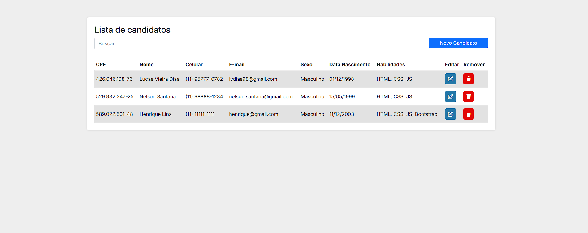
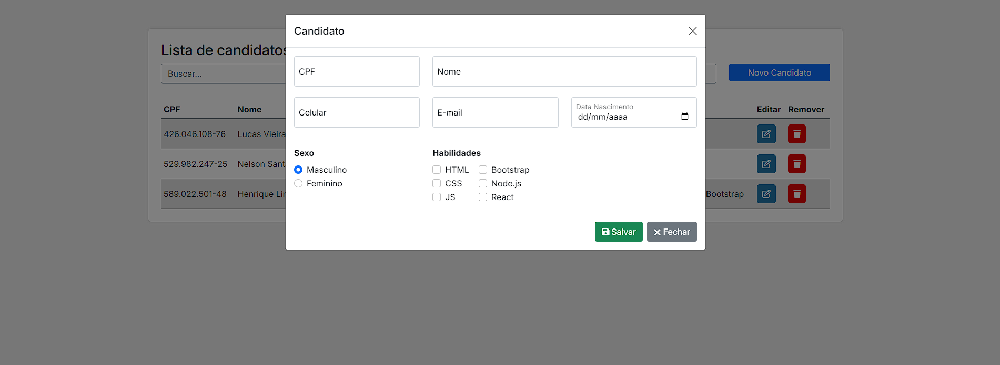

# Teste Applay

Sistema de cadastro de candidatos da Applay.

### Funcionalidades

- Cadastro e edição de candidatos
- Pesquisa na lista
- Exclusão de candidatos
- Validação de CPF e CPF único
- Validação de nome completo
- Validação de idade
- Campos obrigatórios
- Seleção de habilidades
- Máscara de CPF e celular
- Persistência dos dados com LocalStorage
- Alertas personalizados
- Ícones nos botões

### Interface

Layout desenvolvido com Bootstrap e estilos próprios, buscando uma interface simples e organizada.

